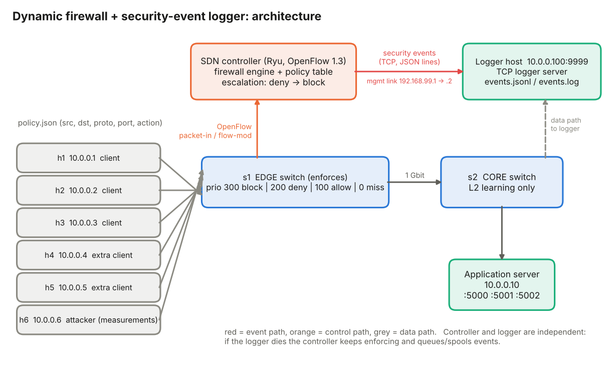
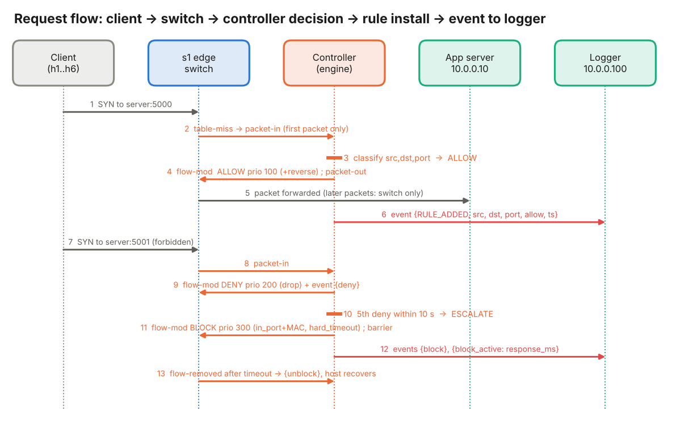

# Dynamic Firewall with Security Event Logger (TCP + SDN)

An SDN controller (Ryu, OpenFlow 1.3) acts as a firewall for a TCP application. It sees the first
packet of every flow, classifies it by **source, destination and port**, installs **allow / deny / block**
rules on the fly, escalates repeat offenders from deny to a timed block, lets them recover
automatically, and reports every security event over a TCP socket to a central logger.




## Status: what was and was not verified

| Part | Verified how |
|---|---|
| Protocols, policy, escalation engine, logger, event sender, TCP app | 54 automated tests, run (`docs/unit_test_output.txt`) |
| Controller logic (flow priorities, timeouts, block / barrier / flow-removed life-cycle, static + nofw compilation) | tests that drive the real controller class with **stubbed** Ryu/OpenFlow objects |
| Ryu + Open vSwitch + Mininet end-to-end (`tests/mininet_functional.py`), measurements, demo | **written but not executed** - the authoring sandbox has no Mininet/OVS. Run `sudo ./demo.sh test` once and fix anything environment-specific (OVS/Ryu versions) before the demo |
| `results/` numbers and graphs | **none are included** - they must come from your own run of `experiments/measure.py` |

## Layout

```
policy.json                   policy table (src, dst, proto, port, action)
common/protocol.py            message formats + validation (app protocol, event protocol)
common/policy.py              policy lookup (most specific rule wins, fail closed)
common/engine.py              decision engine: classify, escalate deny->block, recover (no OpenFlow)
common/eventsender.py         non-blocking, reconnecting, spooling client for the logger
controller/firewall_controller.py   Ryu app: thin adapter engine <-> OpenFlow   (modes: dynamic | static | nofw)
app/server.py, app/client.py        concurrent TCP server (thread per client) and client
logger/logger_server.py       central logger (thread per connection, ACK/ERR, dedupe, timestamps)
topo/topo.py, topo/harness.py       Mininet topology (+CLI) and the "Lab" helper used by tests/measurements
tests/                        unit tests, controller-glue tests, Mininet functional tests
experiments/                  attack.py, legit_loop.py, measure.py, plot.py, render.py
demo/demo.py, demo.sh         narrated demo and one-command test/measure runner
docs/                         diagrams, TESTS.md (expected output), unit test output
```

## Policy table

`policy.json` - the most specific matching rule wins (exact IP > CIDR > `*`, exact port > `*`, deny beats allow on a tie); everything else is **deny**.

| src | dst | proto | port | action | purpose |
|---|---|---|---|---|---|
| `*` | server 10.0.0.10 | tcp | 5000 | **allow** | main application, every client |
| h2 10.0.0.2 | server | tcp | 5002 | **allow** | restricted service - per-source classification |
| `*` | server | tcp | 5001 | **deny** | admin port |
| `*` | logger 10.0.0.100 | tcp | `*` | **deny** | clients may not reach the logger |
| `*` | `*` | icmp | `*` | **allow** | connectivity tests |
| `*` | `*` | `*` | `*` | **deny** (default) | e.g. h1 -> server:22 or h1 -> server:5002 |

Expected behaviour

| Traffic | What happens | Switch state | Logger event |
|---|---|---|---|
| **Allowed** (h1 -> :5000) | first SYN -> packet-in -> allow; later packets never reach the controller | prio 100 forward rule + reverse rule (idle 30 s) | `RULE_ADDED allow` |
| **Denied** (h1 -> :5001) | SYN dropped silently (client sees a *timeout*, not a refusal) | prio 200 drop rule for that 4-tuple (idle 5 s) | `RULE_ADDED deny` |
| **Blocked** (5 denies from one host within 10 s) | *all* traffic from the host dropped, including ARP/ICMP and allowed ports | prio 300 drop on `in_port + eth_src`, `hard_timeout` = 20 s; its per-flow rules are removed | `RULE_ESCALATED block`, later `CONTROLLER block_active` (barrier-confirmed, with `response_ms`) |
| **Recovery** | rule expires in the switch (FLOW_REMOVED) - no controller action needed; counters reset | prio 300 rule gone | `RULE_EXPIRED unblock` (+ dropped packet count) |

Timings are environment variables of the controller: `FW_THRESHOLD=5`, `FW_WINDOW=10`, `FW_BLOCK_TIME=20`, `FW_ALLOW_IDLE=30`, `FW_DENY_IDLE=5`.

## Message formats

**Application protocol** (client <-> server, TCP, text lines, max 1024 bytes):
`PING`->`PONG`, `ECHO <text>`->`ECHO <text>`, `TIME`->`TIME <iso>`, `GET <n>`->`OK <n>\n`+n bytes, `QUIT`->`BYE`; anything else -> `ERR <code> <message>`.
The server answers bad input with `ERR` (closing after 5 in a row), drops idle clients after 30 s (`ERR timeout`), survives clients that vanish mid-transfer. It listens on 5000 (open), 5001 (denied) and 5002 (h2 only) so the firewall has something real to protect.

**Security event** (controller -> logger, one JSON object per line):
```json
{"eid":"4121-1761197460-17","ts":1761197460.123456,"type":"RULE_ADDED","src":"10.0.0.1",
 "dst":"10.0.0.10","port":5001,"action":"deny","dpid":1,"detail":{"proto":"tcp","sport":41000,"rule":"admin port"}}
```
`type` in `RULE_ADDED | RULE_ESCALATED | RULE_EXPIRED | CONTROLLER`, `action` in `allow | deny | block | unblock | info`.
The logger replies `ACK <eid>` or `ERR <code>` (`bad_json`, `missing_field`, `bad_field`, `too_long`, `idle_timeout`), adds `recv_ts`, de-duplicates on `eid` (also across restarts) and writes `events.jsonl` + `events.log`.

## Setup (Ubuntu 20.04/22.04 VM)

```bash
sudo apt install mininet openvswitch-switch python3-pip
pip3 install -r requirements.txt          # ryu + eventlet==0.30.2 (newer eventlet breaks Ryu) + matplotlib
```

## Run

Scripted (starts and stops everything itself):
```bash
sudo ./demo.sh            # narrated demo, ~1 min
sudo ./demo.sh test       # unit tests + Mininet functional tests
sudo ./demo.sh measure    # quick measurements + graphs   (./demo.sh measure full for the whole grid)
```
By hand, in three terminals:
```bash
FW_MODE=dynamic ryu-manager controller/firewall_controller.py     # 1 controller
sudo python3 topo/topo.py                                          # 2 Mininet CLI (starts logger + server)
mininet> h1 python3 app/client.py --host 10.0.0.10 --port 5000     # allowed
mininet> h1 python3 app/client.py --host 10.0.0.10 --port 5001     # denied (timeout)
mininet> attack h3 100 1000-1300                                   # port sweep -> h3 gets blocked
mininet> flows s1                                                  # = ovs-ofctl -O OpenFlow13 dump-flows s1
```
Logger output: `logs/events.log`. The controller needs the logger at `192.168.99.2:9999` (the management link between the root namespace and the logger host); override with `LOGGER_HOST` / `LOGGER_PORT`.

Controller modes (`FW_MODE`): `dynamic` (this project), `static` (the same `policy.json` compiled once into permanent flows - a classic ACL: no packet-ins, no logging, no escalation), `nofw` (plain switching). They exist for the comparison in the measurements.

## Measurements

`experiments/measure.py` (then `experiments/plot.py`) writes `results/*.csv`, `results/summary.md` and `results/graphs/*.png`:

* **Blocking response time** = first violation seen by the controller -> barrier reply confirming the drop rule in the switch, split into *detection* (time to collect `threshold` violations, depends on the attack rate) and *install* (decision -> barrier). Also observed externally by polling the flow table. Swept over attack rate and threshold.
* **Network impact** with 1, 3, 5 legitimate clients and attack rates 0 / 50 / 200 / 1000 attempts/s: RTT p50/p95/p99 and connect time of legitimate sessions, bulk throughput (25 MB GET), peak flow-table size on s1, and how many attacker connections reached the server.
* **Cold start**: first connection (flow set-up through the controller) vs later connections.
* Compared across **no firewall**, **static ACL**, **dynamic firewall**.

## Design decisions worth knowing

* **Decision logic is separate from OpenFlow** (`common/engine.py`), so it is unit-tested without a network.
* **Deny rules match the full 4-tuple** (incl. source port): every *new* connection attempt reaches the controller and is counted, so escalation works; SYN retransmissions are absorbed by the switch. After a block, no further packet-ins arrive - the attacker cannot overload the controller (visible in `hard` test: ~5 deny events for 1000 attempts).
* **Block = `in_port + eth_src`**, so it drops everything (ARP, ICMP, any port). Recovery is the switch's own `hard_timeout`; a fallback timer in the controller covers a lost FLOW_REMOVED.
* **Logger independence**: `send()` never blocks; events go to a bounded queue, reconnect uses exponential back-off, queued events are also spooled to `controller_spool.jsonl`, delivery is at-least-once with de-duplication in the logger. Enforcement continues when the logger is down.
* **Measured "active"** means barrier-confirmed, not merely "flow-mod sent".

## Limitations

* Allow rules match IP + destination port (not source port), so a flood of connections to an **allowed** port is not detected; that would need per-connection rules, meters or flow-stat polling.
* IPv4 broadcast/multicast is flooded unclassified; spoofed MAC/IP is out of scope; one edge switch enforces (`FW_EDGE_DPIDS`).
* The event queue holds 20 000 events; beyond that the oldest are dropped (counted in `EventSender.dropped`).
* Ryu is unmaintained; `eventlet==0.30.2` is pinned for that reason.

## Who explains what

| Member | Part | Files |
|---|---|---|
| A | **Application** - protocols, concurrent server, client, error/timeout handling, topology | `common/protocol.py`, `common/netutil.py`, `app/`, `topo/` |
| B | **Controller rules** - policy table, engine, priorities, escalation/recovery, static/nofw modes | `policy.json`, `common/policy.py`, `common/engine.py`, `controller/`, `tests/test_policy_engine.py`, `tests/test_controller_glue.py` |
| C | **Logging and measurement** - logger, event sender/spooling, tests, attack tool, measurements, graphs | `logger/`, `common/eventsender.py`, `experiments/`, `tests/test_logger_sender.py`, `tests/mininet_functional.py`, `demo/` |
